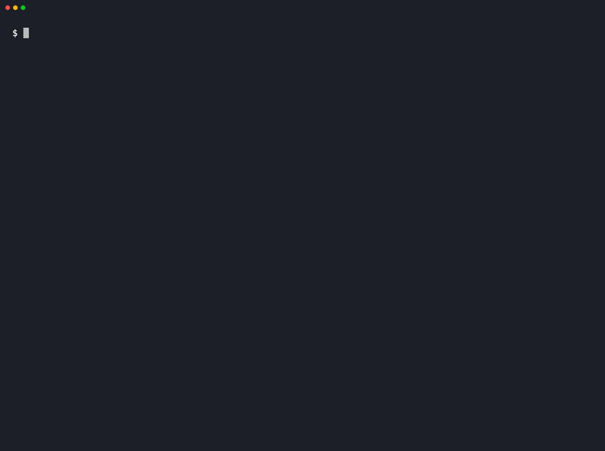
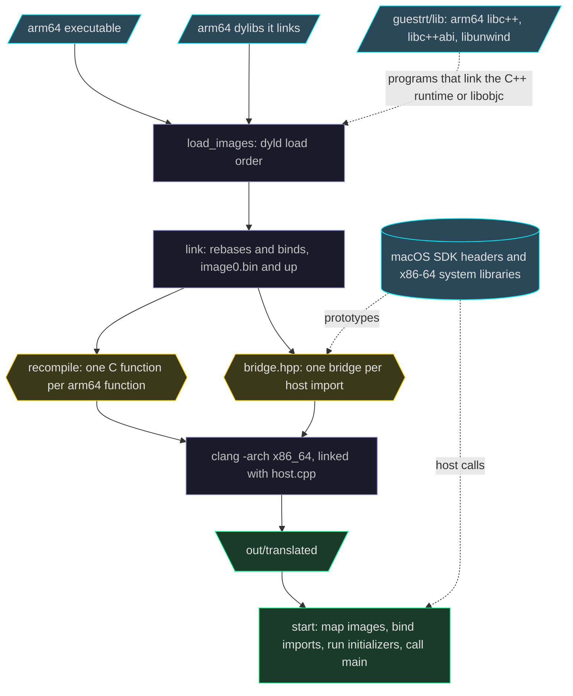

<h1 align="center">arm64-x86-recomp</h1>

<p align="center"><em>The arm64 code never runs. Its x86-64 translation does.</em></p>

<p align="center">
  <a href="LICENSE"></a>
  
  
</p>

You have a macOS program built only for arm64, and a Mac with an Intel CPU.
arm64-x86-recomp is a static binary translator: it lifts the program and the arm64 dylibs it links to C, compiles that C for x86-64, and links one native executable for the Intel Mac.
Calls into macOS go to the Intel Mac's own system libraries, through a bridge that the translator generates for each imported symbol.
In the code and these docs, the translated arm64 program is the guest and the Intel Mac's native side is the host.

It is meant for arm64-only command-line programs: by default a translation is headless, and `--ui-guard-off` lets a translated app reach the window server and the GPU.
You need the right to run any program you translate (see [THIRD_PARTY_NOTICES.md](THIRD_PARTY_NOTICES.md)).

## Example: SQLite on an Intel Mac

<p align="center"></p>

The SQLite 3.54.1 shell, built for arm64 only on an Apple-silicon Mac, translated and run on an Intel iMac (Core i9-10910).
The recording reuses compiled chunks from an earlier translation; a first translation of `sqlite3` takes about two minutes on this Mac.

[examples/sqlite/run.sh](examples/sqlite/run.sh) repeats the comparison on any Intel Mac.
It downloads the SQLite amalgamation and `speedtest1.c` at pinned hashes, builds each for arm64 and for x86-64, translates the arm64 builds, and compares their output with the native x86-64 builds:

- [suite.sql](examples/sqlite/suite.sql), with an in-memory and with an on-disk database: 200,000 inserts, an index, grouping, window functions, JSON, FTS5, R*Tree, math functions and `printf` formats. The output is byte-identical.
- [mandelbrot.sql](examples/sqlite/mandelbrot.sql), the recursive query in the recording: byte-identical.
- `speedtest1 --verify --size 25`, SQLite's own benchmark: the same verification hash.

On the same Intel iMac, suite.sql takes 0.5 s as a native x86-64 build and 0.95 s translated, whether Apple clang 17 (what `run.sh` uses on an Intel Mac) or Apple clang 21 built the arm64 binary.

## Features

- **Translated ahead of time** — each arm64 function becomes a C function over a CPU-state struct, and the output executes no arm64 code.
- **The whole load graph** — the executable and the arm64 dylibs it links are translated into one `translated` executable; a dependency that has an x86-64 slice is used natively instead.
- **Typed calls into macOS** — a call to a C function that the SDK headers declare is bridged from the Apple arm64 calling convention to the x86-64 one, with the types of its prototype; calls with special rules, such as `printf` or `objc_msgSend`, have hand-written bridges.
- **Objective-C, blocks and Swift** — guest classes are registered with the host Objective-C runtime, guest blocks become host blocks, and Swift imports are bridged with signatures read from swiftc's own LLVM IR.
- **C++ and its exceptions** — the C++ runtime a program links is replaced by arm64 builds of libc++, libc++abi and libunwind, translated with the program.
- **Loud stops** — an instruction, import or control transfer it cannot translate stops the program with a `FATAL:` line on stderr and exit status 70.
- **Differential tests** — most test beds build each program for arm64 and x86-64 and compare the translated run with the native one.

## Install

You need:

- **An Intel Mac.** The lifted code is compiled with `-mavx2 -mfma -mbmi -mbmi2 -mlzcnt -mpopcnt -mf16c -maes -mpclmul`, so its CPU must have those extensions: in practice Intel's Haswell generation (2013) or newer.
  `sysctl machdep.cpu.features machdep.cpu.leaf7_features machdep.cpu.extfeatures` lists them (look for AVX2, BMI1, BMI2, FMA, F16C, AES, PCLMULQDQ, POPCNT and LZCNT).
- **Xcode Command Line Tools.** The translator runs `/usr/bin/clang` and `/usr/bin/clang++`, and through `xcrun` it runs `swiftc` and `swift-demangle` and finds the SDK.
- **Python 3.9 or newer**, with the packages in `requirements.txt` (capstone, libclang and unicorn).
- **CMake**, only for building the guest C++ runtime.

Create the Python environment at the repository root, where the scripts' usage lines expect `sbtenv/bin/python`:

```sh
/usr/bin/python3 -m venv sbtenv
sbtenv/bin/pip install -r requirements.txt
```

Build the guest C++ runtime before you translate a C++ or Objective-C program, and before you run the tests:

```sh
guestrt/build.sh
```

The script downloads the LLVM 20.1.8 source release from GitHub when `guestrt/src` lacks it, checks its SHA-256, builds arm64 libunwind, libc++abi and libc++, and copies them to `guestrt/lib`.
[guestrt/BUILD.md](guestrt/BUILD.md) has the build configuration and the scripts that verify it.

## Quick start

Write a small C program, `hello.c`:

```c
#include <stdio.h>

int main(int argc, char **argv) {
    printf("hello from arm64, %d args\n", argc - 1);
    return 0;
}
```

Build it for arm64 only:

```sh
clang -arch arm64 -isysroot "$(xcrun --show-sdk-path)" -O1 hello.c -o hello
```

Translate it into the directory `out`:

```sh
sbtenv/bin/python tools/translate.py hello out
```

The command prints the build report; when it succeeds, the last line ends in `unsupported instructions: 0 | build error: none` and the exit status is 0.
Run the translation:

```console
$ out/translated a b
hello from arm64, 2 args
```

Three things to know before your own program:

- **The first translation in a checkout is slower.** It builds the Swift signature database `sbt/swift_sigs.json` from the Swift corpus with `swiftc`; later translations reuse it, and compiled chunks are cached in `sbt/build/objcache`.
- **Keep `out` where it is.** `translated` reads the guest images `out/image0.bin`, `out/image1.bin` and so on from their absolute paths each time it starts.
- **`--ui-guard-off` is the only option.** It switches off the UI guard described under [Limits](#limits); any other `--` option is refused with the usage line.

## How it works



`sbt/gdyld.py` is the loader, linker and build driver, and `tools/translate.py` is a thin command line around its `translate()` function.
It loads the executable and its arm64 dylibs in dyld's order, applies their rebases and binds, and writes each image's memory to `image<k>.bin`.
`sbt/recompile.py` lifts every function to C, with `sbt/lift_scalar.py` and `sbt/lift_neon.py` covering the scalar and NEON instruction families.
Each host import gets one entry in the generated `bridge.hpp`, and the host runtime in `sbt/gbridge.hpp`, `sbt/gobjc.hpp` and `sbt/gswift.hpp` is compiled into the generated `host.cpp`.
clang compiles all of it for x86-64 and links `translated`.
At start, `translated` maps the guest images at fixed addresses from `0x200000000`, binds the host imports, registers the Objective-C classes and Swift records, runs the initializers in dependency order, and calls the program's `main`.

[docs/how-it-works.md](docs/how-it-works.md) follows each step and lists the files in the output directory.

## Limits

- Only the executable and the arm64 dylibs it links are translated; `dlopen` of any other arm64 file returns `NULL`, and `dlerror()` says why.
- Code the program generates while it runs is not translated; a branch outside the translated images and the known bridges stops with `FATAL: indirect branch to an unmapped target`.
- SVE and SME instructions are lifted to a stop that fires only if one runs; other instructions with no lifter case are counted on the last line of `tools/translate.py`, which then exits 1.
- With the UI guard on (the default), AppKit, Metal and the window-server and display functions stop the program before they run.
- The input must be a thin arm64 Mach-O executable with an `LC_MAIN` entry point.

[docs/limits.md](docs/limits.md) lists each stop with its message, and the extension points for host libraries outside the SDK.

## Run the tests

A bed is a test runner under `tests/` (the instruction-level ones are in `sbt/`).
Most beds build each program for arm64 and x86-64, translate the arm64 build, and compare its stdout and exit status with the native run.

```sh
sbtenv/bin/python tools/run_beds.py                    # every bed, 4 at a time
sbtenv/bin/python tools/run_beds.py --jobs=2 adv cxx   # two named beds, 2 at a time
```

Each bed writes `tests/beds_logs/<bed>.log`, and `run_beds.py` prints one line per bed with its exit status, seconds and last summary line.
Most bed runners exit 0 even when a case fails, so read the summary lines: `run_beds.py` exits 1 only when a bed exits nonzero.
Beds of your own go in `tools/beds_local.txt`, which git ignores.

[docs/testing.md](docs/testing.md) lists every bed, the `beds_local.txt` format, and the runners that are not in the default list.

## Debugging a translated program

`translated` reads a few environment variables when it starts.
`GDYLD_CRASH_TRACE=1` prints a host backtrace on a crash, `GDYLD_TRACE_IMPORTS=1` counts the calls to each host import, and `GDYLD_STOP_AT_IMPORT=name` stops the program before a named import runs.
[docs/environment.md](docs/environment.md) lists every variable the runtime and the translator read.

## Documentation

- [docs/how-it-works.md](docs/how-it-works.md) — the translation steps, the output directory and what `translated` does at start.
- [docs/limits.md](docs/limits.md) — what stops a translation or a translated program, and the extension points.
- [docs/environment.md](docs/environment.md) — environment variables of the translator, the runtime and the beds.
- [docs/testing.md](docs/testing.md) — the bed suite and the instruction-level tests.
- [docs/lifter.md](docs/lifter.md) — adding an instruction to the lifter.
- [guestrt/BUILD.md](guestrt/BUILD.md) — the guest C++ runtime build.

## Contributing

To add an instruction that a translation reports as unsupported, [docs/lifter.md](docs/lifter.md) shows where its case goes and how to test it against the Unicorn emulator.
[docs/testing.md](docs/testing.md) covers the beds that check whole programs.

## License

[MIT](LICENSE).
The repository bundles no third-party code; the LLVM runtime sources and the Python packages are fetched at setup time under their own licenses, as [THIRD_PARTY_NOTICES.md](THIRD_PARTY_NOTICES.md) lists.
